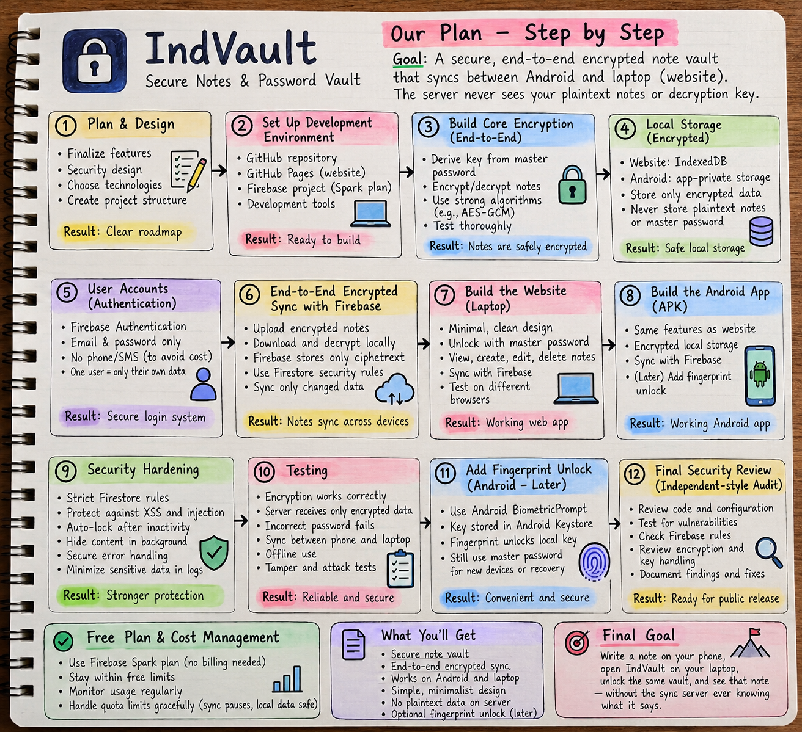

# IndVault

**A privacy-first notes and password vault — planned around end-to-end encryption.**

> **Project status:** The roadmap below describes the intended build and security-review process. It is not a claim that every security feature is already implemented or independently audited. Do not store real passwords, recovery codes, or financial details in the current version until the encryption and security work is complete and verified.

**Live site:** [IndVault on GitHub Pages](https://sizumaru21-collab.github.io/IndVault/)

## Our roadmap

The project will be built in stages, with security checks throughout development and an independent-style review before public release.

*The image is a project plan. Actual implementation, testing, and security review must be completed before features are described as secure or production-ready.*

## Planned priorities

- **End-to-end encryption:** Encrypt note contents on the device before saving or syncing them. The server should receive ciphertext, not readable notes or a usable decryption key.
- **Encrypted local storage:** Store encrypted records locally; do not rely on a PIN screen as encryption.
- **Cross-device sync:** Sign in on the website and Android app, then decrypt vault data locally using the user's secret.
- **Safe recovery:** Design a recovery method before launch and explain clearly that lost secrets may mean lost data.
- **Security hardening:** Enforce per-user database rules, protect against injection and cross-site scripting (XSS), auto-lock after inactivity, and avoid logging sensitive content.
- **Android app:** Add native biometric unlock only after the core vault and sync are secure. Biometrics will be a local convenience, not a replacement for vault encryption.
- **Independent-style review:** Review code, encryption/key handling, database rules, recovery, sync conflicts, and release configuration; fix and retest critical/high-severity findings before public release.

## Planned technology and hosting

- **Website:** HTML, CSS, and JavaScript hosted on GitHub Pages.
- **Sync/authentication:** Firebase Authentication and Cloud Firestore, subject to current free-plan limits and correctly configured security rules.
- **Android:** A later APK build with app-private encrypted storage and Android Keystore-backed local unlock.

Free-tier availability and quotas can change. The project will avoid attaching a billing account to the Firebase project during the free-plan prototype, and sync must fail safely if quotas are reached. “Free forever” cannot be guaranteed.

## Development principles

1. Encryption before cloud sync.
2. Never treat a PIN overlay or biometric animation as data protection.
3. Never upload plaintext note content or the master password.
4. Never silently overwrite conflicting edits during sync.
5. Test with dummy data first; do not use real secrets until security checks are complete.
6. Document known limitations honestly and do not claim the vault is “unbreakable.”

## GitHub Pages setup

1. Keep `README.md` in the repository root.
2. Upload the `assets/` folder with `assets/indvault-roadmap.png` inside it.
3. Keep the website files (including `index.html` and `manifest.json`) in the repository root unless the deployment configuration says otherwise.
4. In GitHub, open **Settings → Pages** and publish from the intended branch and folder.

## License

Add a `LICENSE` file to the repository if you intend to distribute this project under a specific open-source license. Do not assume a license applies until that file is present.
